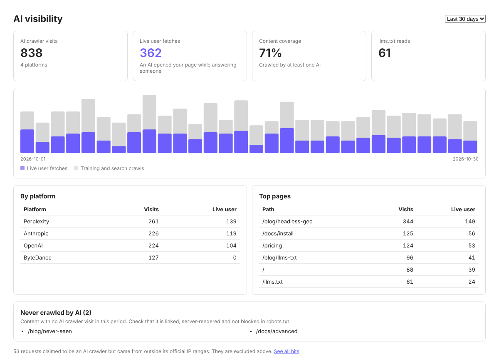
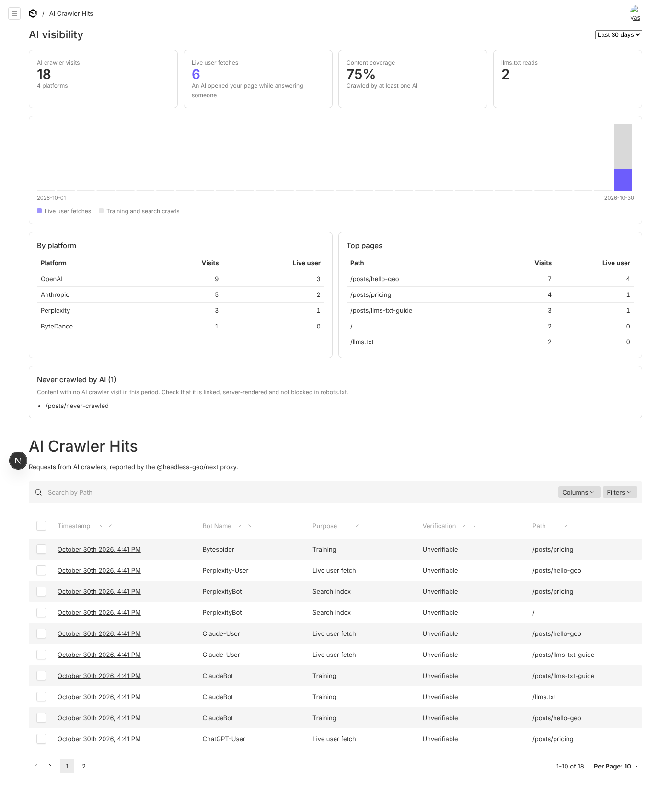
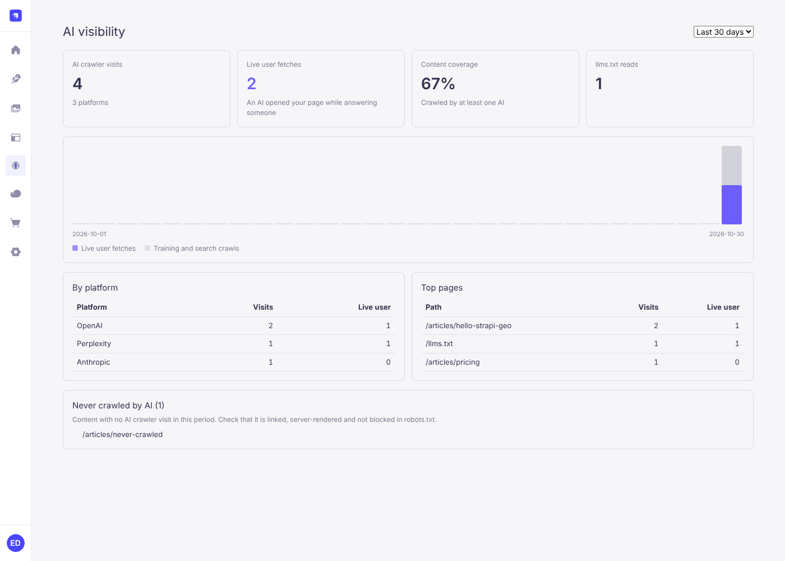

# Askbeam

**English** | [简体中文](README.zh-CN.md) | [Русский](README.ru.md)

**See which AI crawlers read your headless CMS content, and make that content easy for AI to read.**
Open-source plugins for Payload 3 and Strapi 5, plus a frontend SDK for Next.js, Astro, Nuxt and plain Node.

[](https://www.npmjs.com/org/askbeam)
[](https://github.com/Askbeam/Askbeam/actions/workflows/ci.yml)
[](LICENSE)



Is ChatGPT reading your site? Is Perplexity opening your pages to answer people's questions? With a headless CMS
you can't tell: the CMS never sees the requests that reach your frontend. Askbeam reports them back and shows them
next to your content.

- **A verified AI crawler log.** Visits from GPTBot, ClaudeBot, PerplexityBot, ChatGPT-User and many more, each
  checked against the vendor's published IP ranges, so fake bots show up as `spoofed` instead of inflating your numbers.
- **Live user fetches.** See when an assistant opened your page because a real person just asked it something.
- **llms.txt, Markdown and JSON-LD from your content.** `/llms.txt`, `/llms-full.txt`, a Markdown version of every
  page (`/blog/post.md`) and schema.org JSON-LD, built from published, publicly readable entries only.
- **A dashboard and editor panel in your admin.** Visits per platform, content coverage, pages no AI has crawled yet,
  and per-page checks while you write.
- **Your data stays with you.** Everything runs in your own CMS and frontend and is stored in your own database.
  Nothing is on until you configure it, and nothing is sent anywhere you didn't configure: no telemetry, no license checks.

Askbeam measures; it doesn't promise anything. Valid output is no guarantee of rich results, AI indexing or citation.

## Quick start

You need a long random secret shared by the CMS and the frontend, for example from `openssl rand -hex 32`. Set it
as `GEO_SECRET` in both.

### Payload 3

Payload and the frontend run in the same Next.js app.

1. Install:

   ```sh
   npm install @askbeam/payload-plugin @askbeam/next
   ```

2. Add the plugin and list the collections to publish to AI:

   ```ts
   // payload.config.ts
   import { geoPlugin } from '@askbeam/payload-plugin'

   export default buildConfig({
     plugins: [
       geoPlugin({
         secret: process.env.GEO_SECRET,
         llms: {
           siteURL: 'https://example.com',
           name: 'Acme',
           description: 'What Acme does, in one sentence.',
           collections: {
             posts: { section: 'Blog', url: (doc) => `/blog/${doc.slug}` },
             pages: { section: 'Pages', url: (doc) => `/${doc.slug}` },
           },
         },
       }),
     ],
   })
   ```

3. Report AI crawler visits from the frontend:

   ```ts
   // proxy.ts (Next 16) or middleware.ts (Next 15), in the same app
   import { withGeo } from '@askbeam/next'

   export const proxy = withGeo({ endpoint: '/api/geo/ingest', secret: process.env.GEO_SECRET })
   ```

4. Run `npx payload generate:importmap` so Payload finds the admin components, then start the app.

The dashboard appears on the admin home (compact) and above the **GEO > AI Crawler Hits** list (full).

### Strapi 5

Strapi and the frontend are separate apps.

1. Install the plugin in Strapi, and the SDK in your frontend:

   ```sh
   npm install @askbeam/strapi-plugin   # in the Strapi project
   npm install @askbeam/next            # in the frontend
   ```

2. Enable the plugin and list the content types to publish to AI:

   ```js
   // config/plugins.js
   module.exports = ({ env }) => ({
     geo: {
       enabled: true,
       config: {
         secret: env('GEO_SECRET'),
         llms: {
           siteURL: 'https://example.com',
           name: 'Acme',
           contentTypes: {
             'api::article.article': { section: 'Blog', url: (doc) => `/blog/${doc.slug}` },
           },
         },
       },
     },
   })
   ```

3. Report AI crawler visits from the frontend:

   ```ts
   // Next.js frontend: proxy.ts (Next 16) or middleware.ts (Next 15)
   import { withGeo } from '@askbeam/next'

   export const proxy = withGeo({
     endpoint: 'https://cms.example.com/api/geo/ingest',
     secret: process.env.GEO_SECRET,
   })
   ```

   Astro, Nuxt or plain Node instead? Use `geoFetchHandler` ([docs/frameworks.md](docs/frameworks.md), [examples/](examples)).

4. Restart Strapi. The dashboard is under **AI Visibility** in the admin menu. llms.txt, Markdown and JSON-LD only
   include content types the **Public** role can `find` ([details](#strapi-what-is-served-publicly)).

<details>
<summary>Screenshots: the dashboard in Payload and in Strapi</summary>





</details>

### Next steps

- Serve [llms.txt on your domain](#llmstxt-on-your-domain), a [Markdown version of each page](#markdown-version-of-each-page)
  and [JSON-LD](#json-ld).
- Check pages while you write with the [editor GEO panel](#editor-geo-panel), and confirm the setup works in
  [Setup status](#setup-status).
- Track [AI referral visits and citation evidence](#ai-referrals-and-citation-evidence).

## What gets recorded

Visits fall into three kinds:

| Purpose | Bots | What it tells you |
| --- | --- | --- |
| `training` | GPTBot, ClaudeBot, KimiBot, CCBot, Bytespider... | Your content was collected for model training |
| `search` | OAI-SearchBot, Claude-SearchBot, PerplexityBot, Kimi-SearchBot, YandexAdditional... | Your content is indexed by an AI search product |
| `user` | ChatGPT-User, Claude-User, Perplexity-User, Kimi-User, Google-GeminiNotebook... | A real person asked an AI a question and it opened your page |

A headless CMS never sees the requests to your frontend, so the frontend reports them:

```
AI crawler ──▶ Next.js proxy (@askbeam/next) ──waitUntil──▶ CMS /api/geo/ingest ──▶ your database
                 detects bot, does not block the page      re-checks UA, verifies IP
```

## Packages

| Package | What it is |
| --- | --- |
| [`@askbeam/payload-plugin`](packages/payload-plugin-geo) | Payload 3 adapter: hits collection, ingest / stats / llms endpoints, dashboard on admin home and hits list |
| [`@askbeam/strapi-plugin`](packages/strapi-plugin-geo) | Strapi 5 adapter: hits content type, ingest / stats / llms routes, "AI Visibility" admin page |
| [`@askbeam/next`](packages/geo-next) | Frontend SDK: proxy that reports AI crawler requests, routes for llms.txt (and its parts) on your domain, a cache notice receiver, and `geoFetchHandler` for Astro / Nuxt / Node |
| [`@askbeam/core`](packages/geo-core) | CMS-agnostic: bot list, IP verification, ingest, llms.txt builder, rich text to Markdown, stats |
| [`@askbeam/dashboard`](packages/geo-dashboard) | Shared React dashboard, rendered by both CMS adapters |

## Strapi: what is served publicly

llms.txt, llms-full.txt, Markdown, JSON-LD and the dashboard's coverage all use one visibility rule, the one an
anonymous REST request gets:

- Only **published** entries (drafts and unpublished entries never appear).
- Only content types whose `find` the **Public** role is allowed (Settings → Users & Permissions → Roles → Public).
  `findOne` alone is not enough, because llms.txt lists entries and pages are looked up by slug.
- Content types whose REST `find` route has custom **policies or middlewares** are skipped: the plugin can't run
  them for an anonymous visitor. Add an `isPublic` check (below) to serve them.
- Each entry passes through Strapi's content API output sanitizer with the Public role's permissions, so private
  fields and relations or media the Public role can't read (an `author` relation without `author.find`, say) are dropped.
- A page that isn't public returns the same `404 Not found` as a page that doesn't exist; lists just leave it out.

For rules the Public role can't express (members-only flags, a route policy, document-level permissions from
another plugin), add `isPublic` to the content type. It gets the sanitized entry and must return `true` to serve it;
anything else, or a throw, hides it:

```js
'api::article.article': {
  url: (doc) => `/blog/${doc.slug}`,
  isPublic: (entry) => entry.visibility === 'public',
},
```

If your frontend reads Strapi with an API token instead, set `llms.publicOnly: false` to serve every listed type
(private fields are still dropped, and `isPublic` still applies).

**Caching.** The plugin caches nothing: every request re-reads the Public role and the published entries, so
publishing, unpublishing and permission changes apply on the next request. Responses carry
`Cache-Control: public, max-age=300` (404s at most 60 s), so a browser or CDN in front may keep serving an
unpublished page for that long. Set `llms.cacheMaxAge` (seconds, `0` for `no-store`), or purge the CDN on unpublish.

## llms.txt on your domain

The CMS serves `/api/geo/llms.txt` and `/api/geo/llms-full.txt`. Assistants look for `/llms.txt` on your site,
so add a route in the frontend:

```ts
// app/llms.txt/route.ts (and the same for app/llms-full.txt/route.ts)
import { llmsRoute } from '@askbeam/next'

export const GET = llmsRoute({ source: `${process.env.CMS_URL}/api/geo/llms.txt` })
```

Only published, publicly readable content is listed. Each entry needs a URL: pass `url(doc)`, or documents
with a `slug` default to `/<collection>/<slug>`. Rich text (Payload Lexical, Strapi Blocks, or Markdown) is
converted to Markdown for llms-full.txt. Title, description and content fields are auto-detected
(`title`, `description` / `excerpt` / `summary`, `content` / `body`) and can be set with
`titleField`, `descriptionField` and `contentField`.

## Markdown version of each page

The CMS serves `/api/geo/markdown?path=/blog/post` for every page listed in llms.txt (same rules: published and
publicly readable only, drafts never). Let the frontend proxy serve it on your domain:

```ts
// proxy.ts / middleware.ts
export const proxy = withGeo({
  endpoint: `${process.env.CMS_URL}/api/geo/ingest`,
  secret: process.env.GEO_SECRET,
  markdown: { source: `${process.env.CMS_URL}/api/geo/markdown` },
})
```

Now `/blog/post.md` returns the article as Markdown, and so does `/blog/post` when the request sends
`Accept: text/markdown` (set `negotiate: false` to turn that off). Paths the CMS doesn't know fall through to your app.
When Payload runs in the same Next.js app, a path works too: `markdown: { source: '/api/geo/markdown' }` (needs
`@askbeam/next` 0.2.1 or later; 0.2.0 looped on its own request unless the proxy's `matcher` excluded `/api`).
Set `llms.markdownLinks: true` in the CMS to point llms.txt entries at the `.md` URLs. To advertise the Markdown
version, add `alternates: { types: { 'text/markdown': '/blog/post.md' } }` to the page's Next.js metadata.

Collections / content types with a `slug` field are looked up by the last path segment; others are scanned, so
give large collections a `slug`. The whole path must match the entry's URL, so the same slug in two collections
(`/blog/same` and `/same`) never resolves to the wrong one.

In Payload, the queries run with `overrideAccess: false` and no user, so collection `read` access (including
per-document `Where` results) decides what is public. `llms.cacheMaxAge` works the same as in Strapi.

## JSON-LD

The CMS serves `/api/geo/jsonld?path=/blog/post` (`application/ld+json`). Render it in the page:

```tsx
// app/blog/[slug]/page.tsx
import { fetchJsonLd, jsonLdScriptProps } from '@askbeam/next'

export default async function Post({ params }: { params: Promise<{ slug: string }> }) {
  const { slug } = await params
  const jsonLd = await fetchJsonLd({ source: `${process.env.CMS_URL}/api/geo/jsonld`, path: `/blog/${slug}` })
  return (
    <article>
      {jsonLd && <script {...jsonLdScriptProps(jsonLd)} />}
      {/* ... */}
    </article>
  )
}
```

`source` must be an absolute URL, because a server component has no request URL to resolve a path against. When the
CMS is in the same app (Payload), pass the path with `base`:
`fetchJsonLd({ source: '/api/geo/jsonld', base: process.env.SITE_URL, path })` (0.2.1 or later). If the source can't be
resolved, `fetchJsonLd` logs a warning and returns `null`.

Configure it per collection / content type in the `llms` options:

```ts
posts: {
  url: (doc) => `/blog/${doc.slug}`,
  jsonLd: { type: 'BlogPosting', extend: (doc) => ({ keywords: doc.tags?.map((t) => t.name) }) },
  faqField: 'faq',          // array of { question, answer } -> FAQPage, and a FAQ section in the Markdown
  authorField: 'author',    // string, { name }, or a list; default `author` / `authors`
  imageField: 'heroImage',  // URL or upload/media object; default `image`, `heroImage`, `coverImage`, `cover`, ...
},
pages: { jsonLd: { type: 'WebPage' } },
```

The default type is `Article`; `jsonLd: false` turns it off. `headline`, `description`, `datePublished`
(`publishedAt` / `publishedDate` / `createdAt`), `dateModified`, `author` (falls back to your organization), `image`
and `publisher` are filled in. Site-wide `llms.logo`, `llms.language` and `llms.mediaURL` (base for relative upload
URLs, default the CMS server URL) are optional. The core builder `buildJsonLd(site, doc)` is exported from
`@askbeam/core` if you'd rather build it in the frontend.

## Editor GEO panel

Every collection / content type in the `llms` config gets a read-only **GEO check** panel in its edit view (Payload:
sidebar; Strapi: content manager side panel). Other collections show nothing. It never writes to the document,
doesn't block saving or publishing, can be collapsed, and works on the current unsaved edits (checks run about 0.8 s
after typing stops).

- **Checks** are deterministic rules, each with a rule id, status (pass / warning / error / N/A, shown as text, not
  only color), reason, field and suggestion: title, description length, body empty or not convertible, subheadings
  on long bodies (a suggestion only), author and date fallbacks, image URL, empty FAQ items, configured field paths
  that don't exist, frontend URL (including `/undefined` slugs), publish status and anonymous visibility. Sources are
  checked only when you map a field (`sourcesField`); the plugin never judges whether content is true. There is no
  "AI ranking" score.
- **Markdown** and **JSON-LD** previews use the same code as the public routes, so the "published version" preview is
  byte-identical to `/api/geo/markdown` and `/api/geo/jsonld`. "Current edits" previews drafts and unsaved changes.
  Both come from an admin-only endpoint (`POST /api/geo/inspect` in Payload, `POST /geo/inspect` in the Strapi admin
  API) that requires a logged-in user who can read the collection, only accepts configured collections, and answers
  `Cache-Control: private, no-store`. In Strapi the preview also goes through the Public sanitizer, so it shows what
  the public will get.
- The JSON-LD tab adds plugin checks (parses, `<` escaped for `<script>`, required / recommended properties, date
  order, absolute URLs, FAQPage on the same page) and links to the Schema.org validator and Google Rich Results Test
  for the live public URL only. Passing the plugin's checks is not the same as rich result eligibility.
- **Fields** shows which document field fed each output value and the fallback used when it was empty.

Options: `editorPanel: false` turns the panel off (Payload: plugin option; Strapi: `llms.editorPanel`);
`llms.checks: { descriptionMin, descriptionMax, titleMax, headingsAfter }` tunes the length suggestions;
`sourcesField` (per collection) turns on the sources check. Payload needs `payload generate:importmap` after
upgrading so it finds the `GeoEditPanel` component. In Payload, field-level read access is not applied to the
"current edits" preview (collection access is).

## Setup status

The full dashboard (Payload: above **GEO > AI Crawler Hits**; Strapi: **AI Visibility**) has a **Setup status** tab
that keeps three kinds of evidence apart:

- **Configuration**: `siteURL`, each mapped collection and how many public documents it has, a sample public
  document, whether ingest is enabled, whether a secret is set (never its value), IP verification.
- **Connectivity test**, only when you press *Run test*: the CMS requests the sample article page, its `.md`
  version, the page with `Accept: text/markdown`, `/llms.txt`, and checks for a JSON-LD tag, each answered as
  OK / Not enabled / Problem / Not verified. The article request carries a one-time token in its User-Agent; when the
  frontend proxy reports it, the CMS recognises the token (only tokens it issued in the last 10 minutes count),
  records "report received with a valid secret" (or "wrong secret", or "ingest disabled") and does **not** store the
  hit, so test traffic never reaches visit counts or coverage. Requests go only to the `siteURL` origin, with a 5 s
  timeout, at most 3 redirects (each re-checked), a 256 KB body cap, and no private or loopback addresses. For local
  development set `diagnostics: { allowPrivateNetwork: true }` (Payload plugin option; Strapi plugin config).
- **Recent evidence**: the newest stored hit, the last accepted report and recent rejected reports (status and
  reason only) since the CMS started. A site with no AI visits yet shows "No data received yet", not an error.

When the frontend is a separate deployment the CMS can't see its environment, so anything without evidence shows
**Not verified**, and the tab lists `curl` commands to check by hand.

## Per-page visits

The editor panel's **Visits** tab shows AI crawler visits to that document's page over 7 / 30 / 90 days: valid
visits (everything but `spoofed`), live user fetches, `.md` reads (counted with the page), a daily chart, platforms,
purposes, IP-check counts and the latest records with their raw request path. The page path comes from the document
through the same URL mapping as llms.txt (published version first), never from its title; query strings, `#` and
trailing slashes are ignored, and hits for another host are left out (add aliases with `llms.hosts:
['www.example.com']`). After a URL change only the new URL is counted. Days are UTC. The CMS loads at most 20,000
matching rows per request, narrowed in the database by path and date, and aggregates them on the server.
"No visits" only means no crawler request reached the site; it says nothing about whether an assistant cites the page.

Already have middleware? Wrap it: `withGeo(options, yourMiddleware)`.
`@askbeam/next` only uses Fetch APIs, so `trackAICrawler(request, ctx, options)` also works in a Cloudflare Worker.

## AI referrals and citation evidence

The dashboard's **AI referrals & citations** tab shows three signals side by side and never adds them up:

| Signal | What it shows | What it doesn't |
| --- | --- | --- |
| AI crawler visits | An AI bot fetched a page (the existing log). | That the page was cited. |
| AI referral visits | A person's browser arrived from an AI assistant (its `Referer`). | Every citation; the Referer can be forged, so it is never shown as verified. |
| Recorded citation evidence | Someone saw a link to the site in an answer and recorded it by hand. | All citations anywhere. "Verified" means a person checked the record, not that the platform confirmed it. |

There is no automatic citation monitoring. A `CitationMonitorProvider` interface is exported from `@askbeam/core`
for a future authorised API; with none configured the tab says "Automatic monitoring: not configured".

### AI referral visits (off by default)

```ts
// CMS (Payload plugin options / Strapi config/plugins.ts `geo.config`)
referrals: { enabled: true }   // needs `secret`

// Frontend proxy
export const middleware = withGeo({
  endpoint: process.env.GEO_INGEST_URL!,
  secret: process.env.GEO_SECRET,
  referrals: {
    endpoint: process.env.GEO_REFERRALS_URL!, // https://cms.example.com/api/geo/referrals ('/api/geo/referrals' for Payload in the same app)
    consent: (req) => req.headers.get('cookie')?.includes('analytics=yes') ?? false, // your consent check (optional)
  },
  ignore: (path) => path.startsWith('/admin'), // e.g. Payload's admin in the same app
})
```

The proxy reports a request only when it is a top-level page load (`Sec-Fetch-Dest: document`, not a prefetch, not
an AI crawler) whose `Referer` host is a known assistant: chatgpt.com / chat.openai.com, perplexity.ai, claude.ai,
gemini.google.com, copilot.microsoft.com, chat.deepseek.com, doubao.com, kimi.com / kimi.moonshot.cn, chat.mistral.ai,
grok.com, meta.ai, you.com, poe.com, phind.com, alice.yandex.ru, giga.chat. Hosts match exactly or as a parent
domain, never as a substring (`chatgpt.com.evil.test` and `?q=chatgpt` don't count). Without a Referer, only an exact
`utm_source=<known host>` counts (ChatGPT adds `utm_source=chatgpt.com`). Pass `rules` (same shape as the exported
`AI_REFERRERS`) on both sides to change the list. Everything else is unknown and not reported; with
`referrals.unknown: true` in the proxy and `recordUnknown: true` in the CMS, external referrals that match no rule are
stored as platform `unknown` (host only) and shown separately, never counted as AI visits.

**Data kept**: timestamp, platform, `referrer` or `utm`, the referrer's host, the landing path (no query string) and
the site host. The proxy sends only the referrer's origin and the path plus `utm_source`; the client IP and
User-Agent are sent for an in-memory rate limit (20 per client and 600 in total per minute) and 30-minute duplicate
filter, and are never stored. No conversation content, full referrer URLs or cross-site identifiers are kept.
Reports need the shared secret (`GEO_SECRET` stays on the server; nothing runs in the browser), are rejected without
one, and go to their own endpoint and table, separate from crawler hits. The connectivity test in **Setup status**
sends a test visit with `Referer: chatgpt.com` and a one-time token, which is recognised and never stored.

### Citation evidence (off by default)

`citations: { enabled: true }` adds a **Citation Evidence** list for recording answers by hand: platform, question,
observed time, cited URL, answer ID, answer link, screenshot, language, region, other conditions, recorded by, status
(pending / verified / invalid) and notes. Records with the same platform + answer ID + cited URL are refused as
duplicates; without an answer ID, telling duplicates apart is up to the reviewer. Only logged-in admins can read or
change them, and no public endpoint serves them.

- **Payload**: collection `geo-citations` with versions (edit history) and `recordedBy` set from the logged-in user;
  screenshots go to a private upload collection `geo-citation-screenshots` (files are served only to logged-in users,
  stored in `./geo-citation-screenshots`; `citations: { screenshots: false }` turns it off). Enabling `referrals` or
  `citations` adds collections, so run a migration on Postgres / SQLite in production (`payload migrate:create`).
- **Strapi**: content types `plugin::geo.ai-referral` and `plugin::geo.citation` are always registered (Strapi creates
  the tables on start) but stay empty unless enabled. Strapi's media library serves files publicly, so evidence has a
  `screenshotRef` text field (where you keep the screenshot) instead of an upload. Created by / updated by are kept by
  Strapi, and the plugin appends each change (who, when, which fields) to a read-only `history` list. The review
  status field is `reviewStatus`, because `status` is reserved in Strapi 5. Admin roles need Content Manager
  permissions on these types to see them.

## IP verification

Each hit is stored with `verification`:

- `verified`: IP is inside the vendor's published list (OpenAI, Perplexity, Kimi, Google-Agent)
- `spoofed`: vendor publishes a list and the IP is not in it, so the User-Agent is fake
- `unverifiable`: no published list (e.g. Anthropic), the list could not be fetched, or no IP

Lists are fetched by the CMS, cached for 24 hours, and a stale list is kept if a refresh fails.
Add your own ranges with `verifyIPs: { staticRanges: { claudebot: ['x.x.x.x/24'] } }` (Payload).

## More features

| Feature | Docs |
| --- | --- |
| JSON-LD presets (Product/Offer, HowTo, LocalBusiness, Person, Organization, BreadcrumbList), stable `@id`s, duplicate / conflict checks | [docs/jsonld-presets.md](docs/jsonld-presets.md) |
| Blocks, Lexical, Strapi components and dynamic zones in Markdown; your own converters | [docs/converters.md](docs/converters.md) |
| Signed cache invalidation notices on publish / edit / unpublish / delete / permission changes, short-cached 404s | [docs/cache.md](docs/cache.md) |
| Large sites: featured / optional entries, grouping, segmented llms.txt parts | [docs/segments.md](docs/segments.md) |
| Retention, preview-first cleanup, CSV / JSON export (dashboard **Data** tab) | [docs/maintenance.md](docs/maintenance.md) |
| Astro, Nuxt and plain Node frontends (`geoFetchHandler`) | [docs/frameworks.md](docs/frameworks.md), [examples/](examples) |
| Extension APIs: bots, rules, field resolution, converters, JSON-LD, change events | [docs/extensions.md](docs/extensions.md), [examples/extension](examples/extension) |
| New options in one place, upgrade and rollback | [docs/config-reference.md](docs/config-reference.md), [docs/migration.md](docs/migration.md) |

## Development

```sh
npm install
npm run build   # core first, then the rest
npm test
npm run typecheck
```

## Roadmap

1. ~~AI crawler logs~~
2. ~~`llms.txt`, `llms-full.txt`, Markdown version of each page (`/xxx.md`)~~
3. ~~JSON-LD from config presets (Article, FAQ)~~, ~~more presets (Product, HowTo, LocalBusiness, BreadcrumbList)~~
4. ~~Admin dashboard~~, ~~per-document sidebar in the editor~~
5. ~~AI referral visits and hand-recorded citation evidence~~; automatic citation monitoring through an authorised API

## License

[MIT](LICENSE)

## Releasing

1. Bump `version` in each `packages/*/package.json` (and the internal `@askbeam/*` dependency versions).
2. Push a tag: `git tag v0.1.0 && git push origin v0.1.0`.
3. The Release workflow builds, tests and publishes every package not yet on npm, using
   [npm Trusted Publishing](https://docs.npmjs.com/trusted-publishers) (no token stored).

One-time setup: npm only lets you add a trusted publisher to a package that already exists, so the first
version of each package is published by hand (`npm login`, then `npm publish -w packages/<pkg> --access public`).
Then, on npmjs.com, open each package's **Settings → Trusted Publisher**, choose GitHub Actions, and enter
owner `Askbeam`, repository `Askbeam`, workflow `release.yml`.
