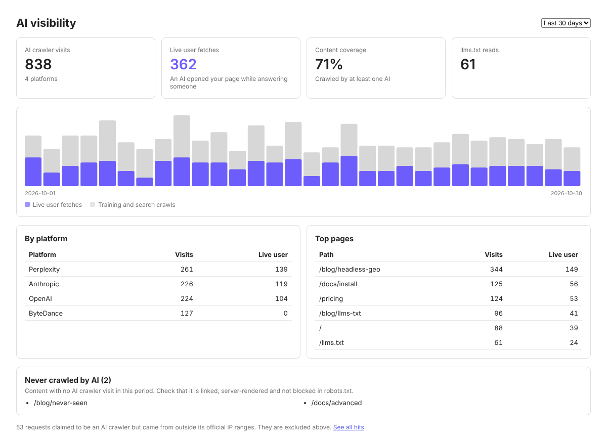
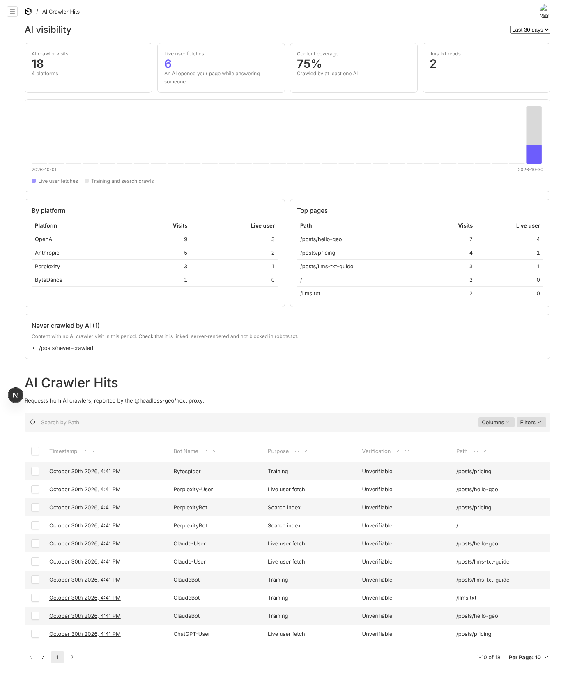
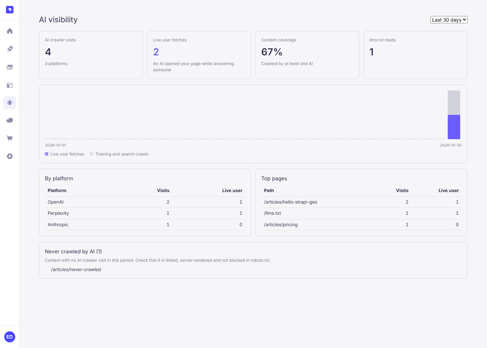

# Askbeam

[English](README.md) | [简体中文](README.zh-CN.md) | **Русский**

**Узнайте, какие AI-краулеры читают контент вашей headless CMS, и сделайте этот контент удобным для AI.**
Открытые плагины для Payload 3 и Strapi 5 и фронтенд-SDK для Next.js, Astro, Nuxt и обычного Node.

[](https://www.npmjs.com/org/askbeam)
[](https://github.com/Askbeam/Askbeam/actions/workflows/ci.yml)
[](LICENSE)



Читает ли ChatGPT ваш сайт? Открывает ли Perplexity ваши страницы, чтобы ответить на вопросы людей? С headless CMS
этого не узнать: запросы приходят на фронтенд, и CMS их не видит. Askbeam передаёт их в CMS и показывает рядом
с вашим контентом.

- **Проверенный журнал AI-краулеров.** Визиты GPTBot, ClaudeBot, PerplexityBot, ChatGPT-User и многих других, каждый
  сверяется с опубликованными диапазонами IP вендора, поэтому поддельные боты помечаются как `spoofed` и не раздувают цифры.
- **Живые запросы пользователей.** Видно, когда ассистент открыл вашу страницу, потому что живой человек только что задал ему вопрос.
- **llms.txt, Markdown и JSON-LD из вашего контента.** `/llms.txt`, `/llms-full.txt`, Markdown-версия каждой страницы
  (`/blog/post.md`) и JSON-LD по schema.org, только из опубликованных и публично доступных записей.
- **Панель и боковая панель редактора в админке.** Визиты по платформам, охват контента, страницы, которые ещё не
  посещал ни один AI, и проверки страницы прямо во время работы над текстом.
- **Данные остаются у вас.** Всё работает в вашей CMS и вашем фронтенде и хранится в вашей базе данных. Пока вы
  ничего не настроили, ничего не включено, и никакие данные не уходят туда, куда вы их не направили: ни телеметрии,
  ни проверки лицензий.

Askbeam измеряет, но ничего не обещает. Корректный вывод не гарантирует расширенных результатов, индексации AI или цитирования.

## Быстрый старт

CMS и фронтенду нужен общий длинный случайный секрет, например из `openssl rand -hex 32`. Задайте его как
`GEO_SECRET` в обоих местах.

### Payload 3

Payload и фронтенд работают в одном Next.js-приложении.

1. Установите пакеты:

   ```sh
   npm install @askbeam/payload-plugin @askbeam/next
   ```

2. Подключите плагин и перечислите коллекции, которые нужно отдавать AI:

   ```ts
   // payload.config.ts
   import { geoPlugin } from '@askbeam/payload-plugin'

   export default buildConfig({
     plugins: [
       geoPlugin({
         secret: process.env.GEO_SECRET,
         llms: {
           siteURL: 'https://example.com',
           name: 'Acme',
           description: 'What Acme does, in one sentence.',
           collections: {
             posts: { section: 'Blog', url: (doc) => `/blog/${doc.slug}` },
             pages: { section: 'Pages', url: (doc) => `/${doc.slug}` },
           },
         },
       }),
     ],
   })
   ```

3. Передавайте визиты AI-краулеров с фронтенда:

   ```ts
   // proxy.ts (Next 16) или middleware.ts (Next 15), в том же приложении
   import { withGeo } from '@askbeam/next'

   export const proxy = withGeo({ endpoint: '/api/geo/ingest', secret: process.env.GEO_SECRET })
   ```

4. Выполните `npx payload generate:importmap`, чтобы Payload нашёл компоненты админки, и запустите приложение.

Панель появится на главной странице админки (компактная) и над списком **GEO > AI Crawler Hits** (полная).

### Strapi 5

Strapi и фронтенд — отдельные приложения.

1. Установите плагин в Strapi, а SDK во фронтенд:

   ```sh
   npm install @askbeam/strapi-plugin   # в проекте Strapi
   npm install @askbeam/next            # во фронтенде
   ```

2. Включите плагин и перечислите типы контента, которые нужно отдавать AI:

   ```js
   // config/plugins.js
   module.exports = ({ env }) => ({
     geo: {
       enabled: true,
       config: {
         secret: env('GEO_SECRET'),
         llms: {
           siteURL: 'https://example.com',
           name: 'Acme',
           contentTypes: {
             'api::article.article': { section: 'Blog', url: (doc) => `/blog/${doc.slug}` },
           },
         },
       },
     },
   })
   ```

3. Передавайте визиты AI-краулеров с фронтенда:

   ```ts
   // Фронтенд на Next.js: proxy.ts (Next 16) или middleware.ts (Next 15)
   import { withGeo } from '@askbeam/next'

   export const proxy = withGeo({
     endpoint: 'https://cms.example.com/api/geo/ingest',
     secret: process.env.GEO_SECRET,
   })
   ```

   У вас Astro, Nuxt или обычный Node? Используйте `geoFetchHandler` ([docs/frameworks.md](docs/frameworks.md), [examples/](examples)).

4. Перезапустите Strapi. Панель находится в меню админки в разделе **AI Visibility**. llms.txt, Markdown и JSON-LD
   включают только типы контента, для которых у роли **Public** разрешён `find`
   ([подробнее](README.md#strapi-what-is-served-publicly), на английском).

<details>
<summary>Скриншоты: панель в Payload и в Strapi</summary>





</details>

### Что дальше

Эти разделы пока есть только на английском:

- Отдавайте [llms.txt на своём домене](README.md#llmstxt-on-your-domain),
  [Markdown-версию каждой страницы](README.md#markdown-version-of-each-page) и [JSON-LD](README.md#json-ld).
- Проверяйте страницы во время работы в [GEO-панели редактора](README.md#editor-geo-panel) и убедитесь, что всё
  настроено, на вкладке [Setup status](README.md#setup-status).
- Отслеживайте [переходы из AI-ассистентов и доказательства цитирования](README.md#ai-referrals-and-citation-evidence).

## Что записывается

Визиты делятся на три вида:

| Назначение | Боты | Что это значит |
| --- | --- | --- |
| `training` | GPTBot, ClaudeBot, KimiBot, CCBot, Bytespider... | Ваш контент собрали для обучения модели |
| `search` | OAI-SearchBot, Claude-SearchBot, PerplexityBot, Kimi-SearchBot, YandexAdditional... | Ваш контент проиндексирован AI-поиском |
| `user` | ChatGPT-User, Claude-User, Perplexity-User, Kimi-User, Google-GeminiNotebook... | Живой человек задал вопрос AI, и тот открыл вашу страницу |

Headless CMS не видит запросов к фронтенду, поэтому о них сообщает фронтенд:

```
AI crawler ──▶ Next.js proxy (@askbeam/next) ──waitUntil──▶ CMS /api/geo/ingest ──▶ your database
                 detects bot, does not block the page      re-checks UA, verifies IP
```

Прокси на фронтенде распознаёт бота, не блокируя страницу; CMS повторно проверяет User-Agent и сверяет IP.

## Пакеты

| Пакет | Что это |
| --- | --- |
| [`@askbeam/payload-plugin`](packages/payload-plugin-geo) | Адаптер для Payload 3: коллекция визитов, эндпоинты ingest / stats / llms, панель на главной админки и над списком визитов |
| [`@askbeam/strapi-plugin`](packages/strapi-plugin-geo) | Адаптер для Strapi 5: тип контента для визитов, маршруты ingest / stats / llms, страница "AI Visibility" в админке |
| [`@askbeam/next`](packages/geo-next) | Фронтенд-SDK: прокси, который сообщает о запросах AI-краулеров, маршруты для llms.txt (и его частей) на вашем домене, приёмник уведомлений о кэше и `geoFetchHandler` для Astro / Nuxt / Node |
| [`@askbeam/core`](packages/geo-core) | Ядро, не зависящее от CMS: список ботов, проверка IP, приём данных, сборка llms.txt, rich text в Markdown, статистика |
| [`@askbeam/dashboard`](packages/geo-dashboard) | Общая React-панель, которую отрисовывают оба адаптера CMS |

Полный справочник по настройкам, проверке IP, обслуживанию данных и API расширений — в [README на английском](README.md) и в [docs/](docs).

## Лицензия

[MIT](LICENSE)
