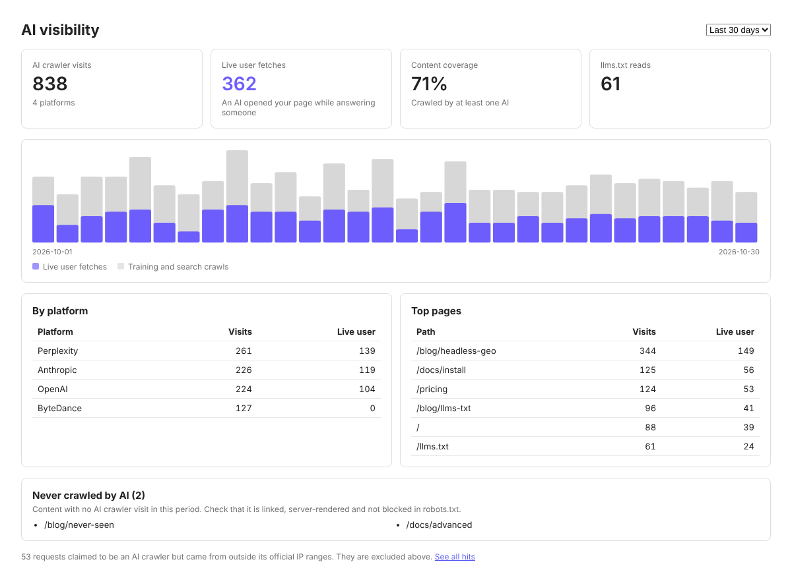
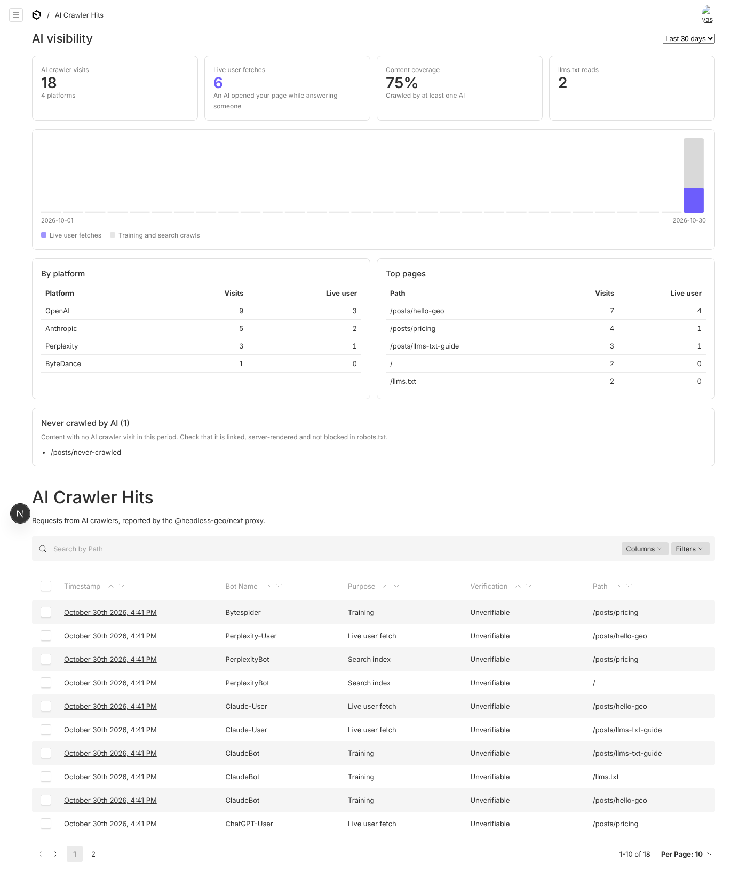
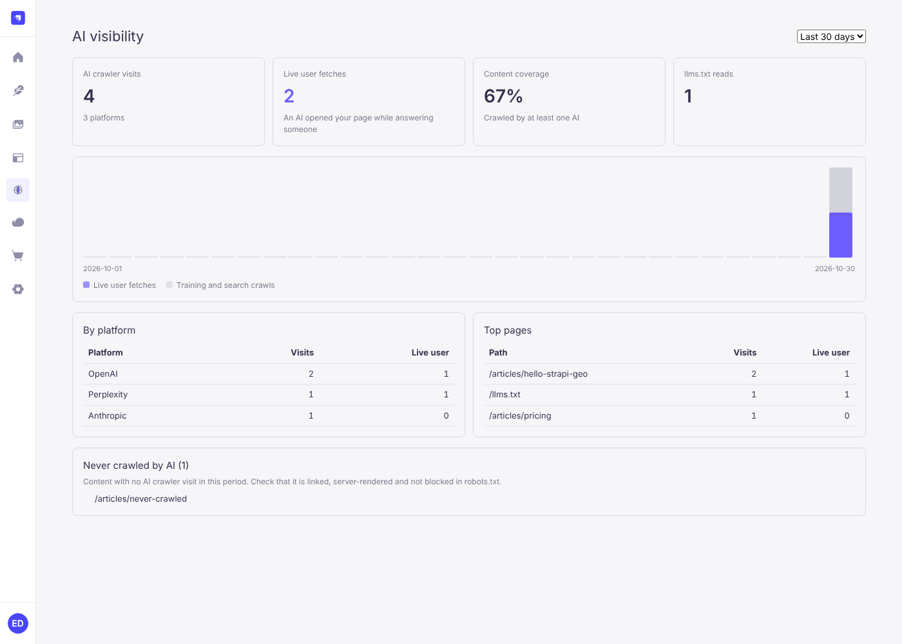

# Askbeam

[English](README.md) | **简体中文** | [Русский](README.ru.md)

**看清哪些 AI 爬虫在读你的 Headless CMS 内容，并让内容更容易被 AI 读懂。**
面向 Payload 3 和 Strapi 5 的开源插件，外加适用于 Next.js、Astro、Nuxt 和纯 Node 的前端 SDK。

[](https://www.npmjs.com/org/askbeam)
[](https://www.npmjs.com/package/@askbeam/core)
[](https://github.com/Askbeam/Askbeam/actions/workflows/ci.yml)
[](LICENSE)
[](https://community.strapi.io/marketplace/askbeam-ai-crawler-visibility)



ChatGPT 在读你的网站吗？Perplexity 会为了回答用户的问题打开你的页面吗？用 Headless CMS 的话你无从得知：
请求打到的是前端，CMS 根本看不到。Askbeam 把这些请求回报给 CMS，并显示在你的内容旁边。

- **经过验证的 AI 爬虫日志。** 记录 GPTBot、ClaudeBot、PerplexityBot、ChatGPT-User 等众多爬虫的访问，并逐条对照厂商公布的
  IP 段核验。伪造的爬虫会被标记为 `spoofed`，不会虚增你的数据。
- **实时用户抓取。** 当真人向 AI 助手提问、助手因此打开你的页面时，你能看到。
- **由你的内容生成 llms.txt、Markdown 和 JSON-LD。** `/llms.txt`、`/llms-full.txt`、每个页面的 Markdown 版本
  （`/blog/post.md`）以及 schema.org JSON-LD，只包含已发布且公开可读的条目。
- **后台里的面板和编辑器侧栏。** 各平台访问量、内容覆盖率、尚未被任何 AI 抓取的页面，以及写作时的逐页检查。
- **数据留在你手里。** 一切都运行在你自己的 CMS 和前端里，存进你自己的数据库。不配置就不启用，也不会向你没配置的地方发送任何数据：
  没有遥测，没有许可证校验。

Askbeam 只负责测量，不做任何承诺。输出合规并不保证获得富媒体结果、被 AI 收录或被引用。

## 快速开始

CMS 和前端需要共用一个足够长的随机密钥，例如用 `openssl rand -hex 32` 生成，在两边都设为 `GEO_SECRET`。

### Payload 3

Payload 和前端运行在同一个 Next.js 应用里。

1. 安装：

   ```sh
   npm install @askbeam/payload-plugin @askbeam/next
   ```

2. 添加插件，并列出要提供给 AI 的集合：

   ```ts
   // payload.config.ts
   import { geoPlugin } from '@askbeam/payload-plugin'

   export default buildConfig({
     plugins: [
       geoPlugin({
         secret: process.env.GEO_SECRET,
         llms: {
           siteURL: 'https://example.com',
           name: 'Acme',
           description: 'What Acme does, in one sentence.',
           collections: {
             posts: { section: 'Blog', url: (doc) => `/blog/${doc.slug}` },
             pages: { section: 'Pages', url: (doc) => `/${doc.slug}` },
           },
         },
       }),
     ],
   })
   ```

3. 在前端上报 AI 爬虫访问：

   ```ts
   // proxy.ts（Next 16）或 middleware.ts（Next 15），同一个应用内
   import { withGeo } from '@askbeam/next'

   export const proxy = withGeo({ endpoint: '/api/geo/ingest', secret: process.env.GEO_SECRET })
   ```

4. 运行 `npx payload generate:importmap`，让 Payload 找到后台组件，然后启动应用。

面板会出现在后台首页（精简版）和 **GEO > AI Crawler Hits** 列表上方（完整版）。

### Strapi 5

Strapi 和前端是两个独立的应用。

1. 在 Strapi 中安装插件，在前端安装 SDK：

   ```sh
   npm install @askbeam/strapi-plugin   # 在 Strapi 项目中
   npm install @askbeam/next            # 在前端项目中
   ```

2. 启用插件，并列出要提供给 AI 的内容类型：

   ```js
   // config/plugins.js
   module.exports = ({ env }) => ({
     geo: {
       enabled: true,
       config: {
         secret: env('GEO_SECRET'),
         llms: {
           siteURL: 'https://example.com',
           name: 'Acme',
           contentTypes: {
             'api::article.article': { section: 'Blog', url: (doc) => `/blog/${doc.slug}` },
           },
         },
       },
     },
   })
   ```

3. 在前端上报 AI 爬虫访问：

   ```ts
   // Next.js 前端：proxy.ts（Next 16）或 middleware.ts（Next 15）
   import { withGeo } from '@askbeam/next'

   export const proxy = withGeo({
     endpoint: 'https://cms.example.com/api/geo/ingest',
     secret: process.env.GEO_SECRET,
   })
   ```

   用的是 Astro、Nuxt 或纯 Node？请使用 `geoFetchHandler`（见 [docs/frameworks.md](docs/frameworks.md) 和 [examples/](examples)）。

4. 重启 Strapi。面板在后台菜单的 **AI Visibility** 下。llms.txt、Markdown 和 JSON-LD 只包含 **Public** 角色有
   `find` 权限的内容类型（[详情](README.md#strapi-what-is-served-publicly)，英文）。

<details>
<summary>截图：Payload 和 Strapi 中的面板</summary>





</details>

### 下一步

以下文档目前只有英文版：

- 在你的域名下提供 [llms.txt](README.md#llmstxt-on-your-domain)、[每个页面的 Markdown 版本](README.md#markdown-version-of-each-page)
  和 [JSON-LD](README.md#json-ld)。
- 写作时用 [编辑器 GEO 面板](README.md#editor-geo-panel) 检查页面，并在 [Setup status](README.md#setup-status) 中确认配置是否生效。
- 追踪 [AI 引荐访问和引用证据](README.md#ai-referrals-and-citation-evidence)。

## 记录哪些访问

访问分为三类：

| 用途 | 爬虫 | 说明了什么 |
| --- | --- | --- |
| `training` | GPTBot、ClaudeBot、KimiBot、CCBot、Bytespider…… | 你的内容被采集用于模型训练 |
| `search` | OAI-SearchBot、Claude-SearchBot、PerplexityBot、Kimi-SearchBot、YandexAdditional…… | 你的内容被 AI 搜索产品收录 |
| `user` | ChatGPT-User、Claude-User、Perplexity-User、Kimi-User、Google-GeminiNotebook…… | 有真人向 AI 提问，AI 因此打开了你的页面 |

Headless CMS 看不到打到前端的请求，所以由前端来上报：

```
AI crawler ──▶ Next.js proxy (@askbeam/next) ──waitUntil──▶ CMS /api/geo/ingest ──▶ your database
                 detects bot, does not block the page      re-checks UA, verifies IP
```

前端代理识别爬虫但不阻塞页面；CMS 再次检查 User-Agent 并核验 IP。

## 软件包

| 软件包 | 说明 |
| --- | --- |
| [`@askbeam/payload-plugin`](packages/payload-plugin-geo) | Payload 3 适配器：访问记录集合，ingest / stats / llms 接口，后台首页和访问列表上的面板 |
| [`@askbeam/strapi-plugin`](packages/strapi-plugin-geo) | Strapi 5 适配器：访问记录内容类型，ingest / stats / llms 路由，后台 "AI Visibility" 页面 |
| [`@askbeam/next`](packages/geo-next) | 前端 SDK：上报 AI 爬虫请求的代理、在你的域名下提供 llms.txt（及其分段）的路由、缓存通知接收器，以及用于 Astro / Nuxt / Node 的 `geoFetchHandler` |
| [`@askbeam/core`](packages/geo-core) | 与 CMS 无关的核心：爬虫列表、IP 核验、数据接收、llms.txt 生成、富文本转 Markdown、统计 |
| [`@askbeam/dashboard`](packages/geo-dashboard) | 共享的 React 面板，由两个 CMS 适配器渲染 |

完整的配置参考、IP 核验、数据维护和扩展 API 请见 [英文 README](README.md) 和 [docs/](docs)。

## 许可证

[MIT](LICENSE)
