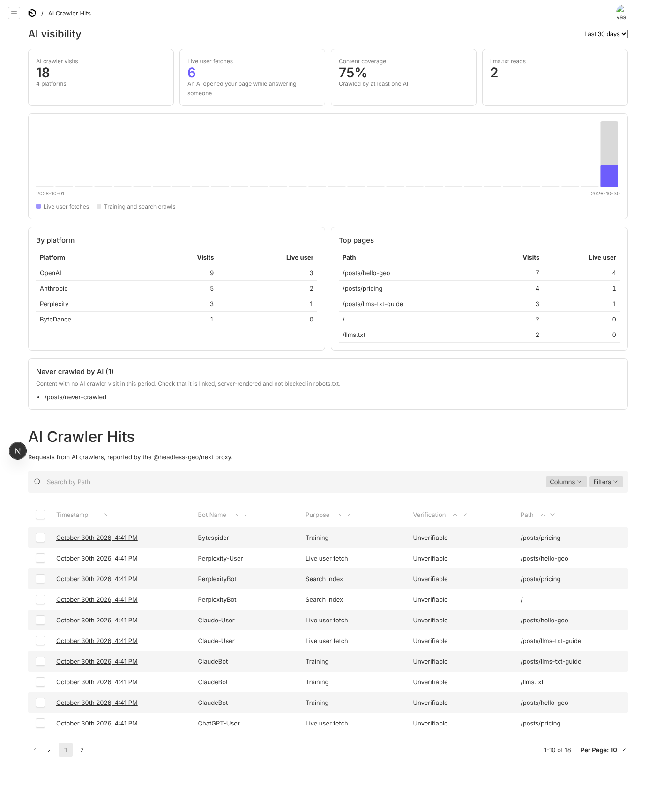

# @askbeam/payload-plugin

[Askbeam](https://github.com/Askbeam/Askbeam) for Payload 3: see which AI crawlers read your site, serve llms.txt, per-page Markdown and JSON-LD, and get an AI visibility dashboard in the admin.

Is ChatGPT reading your site? Payload can't see the requests that reach your frontend, so it can't tell you. This
plugin can: a verified log of GPTBot, ClaudeBot, PerplexityBot, ChatGPT-User and others, stored in your own database.



```sh
npm install @askbeam/payload-plugin @askbeam/next
```

```ts
// payload.config.ts
import { geoPlugin } from '@askbeam/payload-plugin'

export default buildConfig({
  plugins: [
    geoPlugin({
      secret: process.env.GEO_SECRET,
      llms: {
        siteURL: 'https://example.com',
        name: 'Acme',
        collections: { posts: { section: 'Blog', url: (doc) => `/blog/${doc.slug}` } },
      },
    }),
  ],
})
```

```ts
// middleware.ts (Next 15) or proxy.ts (Next 16), in the same app
import { withGeo } from '@askbeam/next'

export const middleware = withGeo({ endpoint: '/api/geo/ingest', secret: process.env.GEO_SECRET })
```

Set `GEO_SECRET` to a long random string (for example `openssl rand -hex 32`), then run
`npx payload generate:importmap`. The dashboard appears on the admin home and above **GEO > AI Crawler Hits**.

Full docs: https://github.com/Askbeam/Askbeam

More: [JSON-LD presets](https://github.com/Askbeam/Askbeam/blob/main/docs/jsonld-presets.md), [converters](https://github.com/Askbeam/Askbeam/blob/main/docs/converters.md), [cache notices](https://github.com/Askbeam/Askbeam/blob/main/docs/cache.md), [large sites](https://github.com/Askbeam/Askbeam/blob/main/docs/segments.md), [data maintenance](https://github.com/Askbeam/Askbeam/blob/main/docs/maintenance.md), [extensions](https://github.com/Askbeam/Askbeam/blob/main/docs/extensions.md), [upgrading](https://github.com/Askbeam/Askbeam/blob/main/docs/migration.md).

## Issues and support

Found a bug or have a question? Open an issue at https://github.com/Askbeam/Askbeam/issues with your Payload version,
the plugin version and the steps to reproduce.

The plugin has no usage tracking and no runtime dependencies besides `@askbeam/core` and `@askbeam/dashboard`.
