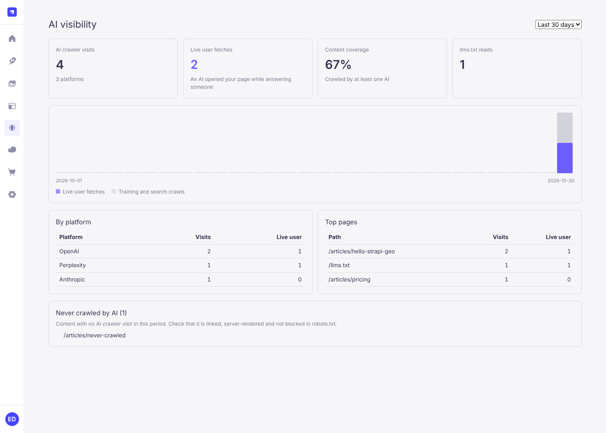

# @askbeam/strapi-plugin

[Askbeam](https://github.com/Askbeam/Askbeam) for Strapi 5: see which AI crawlers read your frontend, serve llms.txt, per-page Markdown and JSON-LD from your content, and get an "AI Visibility" page in the admin.

Also listed on the [Strapi Marketplace](https://community.strapi.io/marketplace/askbeam-ai-crawler-visibility).

Is ChatGPT reading your site? Strapi can't see the requests that reach your frontend, so it can't tell you. This
plugin can: a verified log of GPTBot, ClaudeBot, PerplexityBot, ChatGPT-User and others, stored in your own database.



```sh
npm install @askbeam/strapi-plugin
```

```js
// config/plugins.js
module.exports = ({ env }) => ({
  geo: {
    enabled: true,
    config: {
      secret: env('GEO_SECRET'),
      llms: {
        siteURL: 'https://example.com',
        name: 'Acme',
        contentTypes: { 'api::article.article': { section: 'Blog', url: (doc) => `/blog/${doc.slug}` } },
      },
    },
  },
})
```

llms.txt, Markdown and JSON-LD only serve what an anonymous REST request could read: published entries of content
types whose `find` the **Public** role is allowed, sanitized like the REST API. Content types with custom route
policies are skipped unless you add an `isPublic(entry)` check. If your frontend reads Strapi with an API token
instead, set `llms.publicOnly: false`. See [What Strapi serves publicly](https://github.com/Askbeam/Askbeam#what-strapi-serves-publicly).

Strapi can't see requests to your frontend, so add [`@askbeam/next`](https://www.npmjs.com/package/@askbeam/next) there:

```ts
import { withGeo } from '@askbeam/next'

export const proxy = withGeo({ endpoint: 'https://cms.example.com/api/geo/ingest', secret: process.env.GEO_SECRET })
```

Set `GEO_SECRET` to the same long random string in Strapi and the frontend (for example `openssl rand -hex 32`).
Restart Strapi and open **AI Visibility** in the admin menu.

Full docs: https://github.com/Askbeam/Askbeam

More: [JSON-LD presets](https://github.com/Askbeam/Askbeam/blob/main/docs/jsonld-presets.md), [converters](https://github.com/Askbeam/Askbeam/blob/main/docs/converters.md), [cache notices](https://github.com/Askbeam/Askbeam/blob/main/docs/cache.md), [large sites](https://github.com/Askbeam/Askbeam/blob/main/docs/segments.md), [data maintenance](https://github.com/Askbeam/Askbeam/blob/main/docs/maintenance.md), [extensions](https://github.com/Askbeam/Askbeam/blob/main/docs/extensions.md), [upgrading](https://github.com/Askbeam/Askbeam/blob/main/docs/migration.md).

## Issues and support

Found a bug or have a question? Open an issue at https://github.com/Askbeam/Askbeam/issues with your Strapi version,
the plugin version and the steps to reproduce.

The plugin has no usage tracking and no runtime dependencies besides `@askbeam/core` and `@askbeam/dashboard`.
